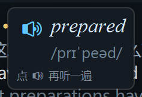

# E听说 作业答案悬浮窗（ets_helper）

在 E听说 客户端旁边叠一个置顶小窗，**自动跟着你当前做的作业、当前做到哪一部分、当前播到哪一句**，把这一部分要说的原文/参考范文显示出来。

不改动 E听说 的任何文件，只读你自己电脑上已经下载好的数据和它自己写的运行日志。

| 黑暗模式 | 白天模式 |
|---|---|
|  |  |

选中一个单词就能看音标、听真人发音：



> 与讯飞 / E听说 官方无关，非授权项目；程序只读本机已有数据，不修改、不破解、不上传。
> 详见 [THIRD_PARTY_NOTICES.md](THIRD_PARTY_NOTICES.md)。

---

## 快速开始

本机装有 Python 3.8+ 的话：

```bash
git clone <this repo>
cd ets_helper
python ets_helper.py --find      # 看一眼能不能找到 E听说 的数据
pythonw ets_helper.py            # 启动（无控制台）
```

不需要安装任何第三方包，`tkinter` 是标准库自带的（Windows 官方 Python 默认包含）。

> 仓库里**不含** `ipa_index.json` / `word_ipa.json`（第三方词库衍生数据，见 NOTICE）。
> 首次运行会自动重建，也可以手动 `python ets_helper.py --prebuild`（约 3 秒）。

---

## 拿到的是什么

| 位置 | 说明 |
|---|---|
| `ets_helper.py` | 主程序（单文件，只用标准库） |
| `启动.bat` | Windows 启动器（优先找 `runtime\pythonw.exe`，其次系统 Python） |
| `使用说明.txt` | 给最终用户的说明 |
| `cmudict.dict` | 补充发音词典（BSD 许可，见 NOTICE） |
| `预览-*.png` | 截图 |

便携版（自带 Python 运行时、免安装）不在仓库里，用 Releases 发布。

---

## 怎么用

1. 双击 `启动.bat`（没有控制台窗口）。想带着控制台看日志就跑 `python ets_helper.py`。
2. 打开 E听说，进入要做的那份作业。
3. 面板出现，内容会自己跟着切换。没跟上就用底部按钮或热键手动翻。

窗口是**可拖拽、可缩放**的：

| 操作 | 做法 |
|---|---|
| 移动整个窗口 | 按住标题区（作业名那一块）拖动 |
| 放大 / 缩小 | 拖窗口的四条边或四个角（鼠标移到边上会变成双箭头） |
| 恢复自动摆位 | 点底部「复位」，或双击标题区 |
| 记住尺寸位置 | 每次拖完/缩完自动记进 `config.json`，下次照旧 |

底部两排按钮就是全部操作，不用记热键：

```
[◀ 部分] [部分 ▶] [◀ 作业] [作业 ▶]
[跟随中] [穿透] [白天/黑暗] [A−] [A+] [复位] [✕]
```

右侧有滑条，内容超出一屏时可以拖；鼠标滚轮直接滚也行。

**两套配色**：点底部「白天 / 黑暗」按钮（或 `Ctrl+Alt+D`）即时切换，不用重启，
选择记在 `config.json` 的 `theme` 里。

| | 背景 | 文字 | 强调色 |
|---|---|---|---|
| 黑暗 | 深墨蓝 `#0d1218` | 近白 | 青蓝 `#5fc9ff` |
| 白天 | 暖米白 `#faf8f3` | 深墨 `#1f262d` | 湖蓝 `#0b6ca8` |

高亮色也跟着换：黑暗模式是深蓝底白字，白天模式是暖黄底黑字，在强光下也能看清。
深夜做题用黑暗，白天/投屏/打印稿对照用白天。

关闭：点「✕」或按 `Ctrl+Alt+Q`。

---

## 热键（全局生效，E听说 在前台也能按）

按钮已经把常用操作实体化了，热键是给"手不离键盘"的场景留的：

| 作用 | 默认键 | 被占用时的备用键 |
|---|---|---|
| 显示/隐藏面板 | `Ctrl+Alt+H` | `Ctrl+Shift+H` / `Alt+Shift+H` |
| 下一部分 / 上一部分 | `Ctrl+Alt+→` / `Ctrl+Alt+←` | `Ctrl+Shift+→` / `Ctrl+Shift+←` |
| 换下一份 / 上一份作业 | `Ctrl+Alt+↓` / `Ctrl+Alt+↑` | `Ctrl+Shift+↓` / `Ctrl+Shift+↑` |
| 回到自动跟随 | `Ctrl+Alt+A` | `Alt+Shift+A` |
| 鼠标穿透 开/关 | `Ctrl+Alt+T` | `Ctrl+Shift+T` |
| 面板移到左/右 | `Ctrl+Alt+M` | `Ctrl+Shift+M` |
| 面板宽度循环 | `Ctrl+Alt+W` | `Ctrl+Shift+W` |
| 切换白天/黑暗 | `Ctrl+Alt+D` | `Ctrl+Shift+D` |
| 字号 大/小 | `Ctrl+Alt+=` / `Ctrl+Alt+-` | 同上规律 |
| 内容上下翻页 | `Ctrl+Alt+PgDn` / `Ctrl+Alt+PgUp` | |
| 退出 | `Ctrl+Alt+Q` | `Ctrl+Shift+Q` |

> 热键经常被别的软件抢（显卡驱动、输入法、截图工具常占 `Ctrl+Alt+方向键`）。被占时程序会自动
> 降级到备用键，具体生效的键写在 `helper.log` 里（`hotkey xxx 改用备用键 ...`）。

**鼠标穿透**（点「穿透」按钮或热键）之后，面板对鼠标完全透明，点它等于点它下面的 E听说，
适合录音时不想误点。注意：穿透状态下**按钮点不动**，要按热键才能切回来（状态行会提示是哪个键）。

---

## 面板上显示什么

| 题型 | 面板内容 |
|---|---|
| 单词朗读 / 语篇朗读 | 要读的原文（单词表原样保留音标和词） |
| 课内/课外语篇听读 | 逐句列表，编号与客户端播放的句子一一对应；正在播的那句会高亮 |
| **角色扮演**（3 问 5 答） | 逐题列出：第 1–3 题「你要提问」（中文提示 + 2–3 种可选英文问句），第 4–8 题「你要回答」（英文问题 + 2–3 种参考答案）；正在做的题会高亮 |
| 故事复述 / 话题表达 | 参考范文 + 要点提示 + 题目 |

底部状态行会显示 `自动跟随`、`共x分`、`● 正在录音`、`▶ 第 n 句`。

### 录音时高亮

录音那一步（日志里 `filetype=action.record`）会高亮你此刻该念的内容：

| 题型 | 高亮规则 |
|---|---|
| 听读（`fjN.mp3`） | 语音先播第 N 句、你复述，所以录音时**第 N 句保持高亮** |
| 角色扮演 | 按题号高亮**当前那一题**（提问/回答各自的候选句整块），题目页面一出现就切 |
| 故事复述 / 话题表达 | **只高亮参考范文**，要点提示和题目不高亮，避免把提示词当成要念的内容 |
| 朗读（整段没有逐句信息） | 整段答案铺一层淡蓝底色 |

> 之前有个 bug：录音瞬间会把句子号清零，高亮正好在最需要的时候消失。已修。
> 换部分时句子号/题号会清零，不会串到上一部分。

### 选中一个单词：音标 + 发音

面板里**选中任意英文单词**（拖选或双击），鼠标旁边会弹出一个小窗：

```
┌────────────────────┐
│ 🔊  prepared        │  ← 喇叭图标：点它就重播；单词是 Times New Roman 斜体
│     /prɪˈpeəd/      │  ← 音标（灰色小字）
│     点 🔊 再听一遍   │  ← 播放状态会短暂占这行，之后换回操作提示
└────────────────────┘
```

- 选中就**自动读一遍**；点喇叭（或小窗任意位置）再听一遍，**点一次会续命**，不会播到一半就没了。
- 弹窗是**圆角**的（Win11 的 DWM 圆角；Win10 上会退回直角）。
- 选中的不是单个英文词（比如一整句、中文、标点）就不会弹。
- **7 秒**后自动消失，点面板别处立刻消失。关闭有两道保险：`after` 定时 + 主循环 tick
  里的截止时间检查（只靠 `after` 的话，Toplevel 重建时定时器会丢）。
- 弹窗是独立置顶窗口；主面板每 3 秒会把置顶重设一次，所以 tick 里会顺手把弹窗也顶上来，
  否则会被面板盖住。

**音源按顺序找**，找到就用：

| 优先级 | 来源 | 说明 |
|---|---|---|
| 1 | 客户端词典的**朗文真人发音** | `pc_xst_dict` 里每个词都带 mp3 地址；首次点开下载约 0.2–0.5 秒，之后缓存在 `voice_cache\`，离线可用 |
| 2 | 本机 **SAPI 语音合成** | 用系统语音读出来；**这台机器没装任何语音包**（SAPI5 和 OneCore 都是 0 个），所以实际走的是第 1 条 |
| 3 | 都没有 | 只显示音标，提示"这个词没有音频" |

词库覆盖：**131,175 个词**有音标，其中约 2.8 万个带真人发音（中考/高考词表 + iciba 词表）。
cmudict 补进来的词只有音标、没有音频。

---

## 客户端装在哪都能用（路径自动发现）

作业数据的位置是**固定的**：`%APPDATA%\ETS`（客户端自己写死）。
但**安装目录在哪完全没准**——可能 `D:\etingshuo`、`C:\Program Files\某个中文目录`、U 盘，
甚至绿色版随便解压到一个文件夹。所以程序不猜路径，而是找**特征文件** `ets_*.log`。

探测顺序（找到即停，并写进 `config.json` 的 `log_dir`）：

| 顺序 | 依据 | 说明 |
|---|---|---|
| 1 | **运行中的客户端进程** | 拿 `ETSShell.exe / Ets.exe / EtingShuo.exe` 的 exe 路径，取同级 `logs\` |
| 2 | **注册表卸载项** | `InstallLocation`、`DisplayIcon`、`UninstallString`、`Inno Setup: App Path`，名称含"听说/ETS" |
| 3 | **App Paths / 快捷方式** | `App Paths\Ets.exe`；开始菜单与桌面 `.lnk` 里解析出目标 exe |
| 4 | **有界全盘搜索** | 在 `%LOCALAPPDATA%`、`%PROGRAMDATA%`、Program Files、各盘根目录按深度 4 搜索 `ets_*.log`，有时间预算 |

- 实测：注册表线索 0.01 秒，快捷方式 0.05 秒，兜底全盘搜索 4.3 秒就能命中。
- **客户端后启动也没关系**：如果启动时没找到，程序每 15 秒重试一次，客户端一开起来就自动接上。
- 想手动确认/强制刷新，跑 `python ets_helper.py --find`，它会打印每一条线索和最终结论，
  并把结果写进 `config.json`。
- 也可以直接在 `config.json` 里写死：`"log_dir": "D:\\etingshuo\\ETS\\logs"`。

---

**角色扮演的题号怎么定**（这题踩过坑）：日志里有三处能拿到题号，只用其中一处都会出问题。

| 信号 | 位置 | 问题 |
|---|---|---|
| `quesNaskaudio / quesNaswaudio` | 音频步骤 | 提问环节（1–3 题）的音频是**录完之后**才播的，用它当题号会**晚一题** |
| 步骤 `order`（`…_custom_order_<entity>_<题号>_<序号>`） | 每个步骤都有 | 导语步骤题号是 0，得保留上一题的号 |
| 录音文件名后缀（`{{st2}}_4`） | 录音步骤 | 只在录音那一刻才有 |

所以现在按 `order 题号 > quesN 音频 > 录音后缀` 三级取，题号在**题目页面出现时**就切换，
比录音早好几秒，不会再晚一拍。实测回放一整份角色扮演的 21 个录音步骤，题号全部对应正确。

### 音标自动还原成单词（斜体，Times New Roman）

单词朗读那一栏，题面给的其实是一堆音标（`/bɜːθ/ /blaɪnd/ …`），照着音标念很别扭。
程序会把音标反查成单词，显示成这样：

```
birth          /bɜːθ/        ← 单词 Times New Roman 斜体，音标是灰色小字
blind          /blaɪnd/
blue · blew    /bluː/        ← 同音词给两个候选，念哪个都对
```

**词库是三本合并的**（同一音标下，靠前的来源优先，所以常见释义来自前两本）：

| 来源 | 词条数 | 说明 |
|---|---|---|
| 客户端 `pc_xst_dict.json` | 2.8 万 | 英/美双音标，中考/高考词表 |
| 客户端 `worddict_data.json`（iciba） | 4.5 千 | 补前一本漏掉的词（如 `chopsticks`） |
| `cmudict.dict`（随程序） | 13.5 万 | CMU 发音词典，ARPAbet 转 IPA，**覆盖全部初高中课标词汇** |

合并后索引 **138,813 个音标 key**，`ipa_index.json` 4.3MB，启动预加载约 **0.13 秒**
（重建一次约 3 秒，`--prebuild`）。

匹配分三级，并带**来源优先级**：

1. **精确**：统一重音、长音、英/美标注写法后直接命中（绝大多数）。
2. **1 个音素差**：`celebrate` 的 `/selɪ-/` vs `/selə-/`、`competition` 的 `t/z` 这类。
3. **2 个音素差但辅音骨架完全一致**：救回 `direction`（`/daɪ-/` 与 `/də-/` 差两个元音），
   同时不会把 `circus` 认成 `circle`。

**来源优先级**很关键：精确命中的如果只是 cmudict 的生僻同音词，会继续在模糊匹配里找
客户端词表的词。所以 `/ˈkæpɪt(ə)l/` 给 `capital` 而不是冷僻的 `capitol`，
`/gru:/` 给 `grew` 而不是 `grewe / grue`。同一音标下的同音词仍会一起列出（`court · caught`、
`ate · eight`），但只列客户端词表里的，不会掺进 cmudict 的怪词。

另外还会自动生成派生写法：英式拼写（`colour`/`centre`/`travelling`/`organise`）、
连字符合成词（`warm-up`）等，所以教材里常见的英式拼法也能查到。

实测：6 份作业、**80 个音标 100% 命中**；作业正文里 1082 个不同单词，98.9% 在库
（剩下的是 `changbai`、`guizhou`、`tianchi`、`gogh's` 这类专有名词和人名所有格，
不影响音标反查）。

> 如果某个音标实在查不到，面板会显示 `（未收录）` + 该音标，照着音标念也可。
> 索引缺失或词典更新过才会现场重建（约 2.8 秒），也可以用 `--prebuild` 手动重建。

- 不想要这个功能就把 `ipa_to_word` 设成 `false`，会原样显示音标。

---

## 它是怎么知道你在做哪一部分的

1. **答案从哪来**：E听说 每打开一份作业，会把内容缓存到
   `%APPDATA%\ETS\<作业号>\` 下面。其中 `content_<id>\content.json` 就是题面、
   原文和参考范文，`template_*\res.json` 给出各部分的顺序、名称、分值。
   本程序只读这些 JSON，不改动、不上传任何东西。
2. **进度从哪来**：客户端的运行日志 `ets_YYYY-MM-DD.log`（在安装目录的 `logs\` 下，
   位置由上面的自动探测确定）每推进一步就追加一行 `FLOW_PRAC exam_step`，
   里面有 `set_id`（作业号）、`entity_id`（当前部分）、`filetype`（`action.record` 表示正在录音）。
   本程序 tail 这个文件判断"你现在在哪"，并把 `fjN.mp3` 映射成"第 N 句"。
3. **作业名**：同样从日志里的 `…, set_id: 306828` 行里取，所以打开过一次就会显示真名，
   否则显示 `作业 306828`。

---

## 已知限制（重要）

- **面板是不透明的，不是半透明。** 这是实测结论：Tk 窗口一旦用半透明（alpha<255），
  背景填充会整块消失只剩文字，变成"幽灵窗"；要保住点击穿透又得用分层窗口。
  所以宁可做成不透明的干净深色面板，位置、大小、宽度都能自己拖。
- **"穿透"状态不会被记住。** 每次启动都是可交互状态，避免下次启动时按钮点不动；
  录音时手动点一下「穿透」即可。
- **只能显示已经缓存过的作业。** 没在客户端里打开过的作业，本地没有数据。
- **听力题/选择题的答案不一定有。** 缓存里只存客户端自己要用到的内容；这套流程实测覆盖
  单词朗读、语篇朗读、听读、故事复述。如果某份作业缓存里没有答案字段，面板会显示
  "这一部分没找到文字内容"，或者只显示能找到的原文——那种题请把题干发给我，我给你做。
- **自动跟随依赖日志。** 如果日志目录没找到（装的不是默认路径），就退化成纯手动翻页：
  面板照样能用，只是不会自动跳。改 `config.json` 里的 `log_dir` 即可。
- **口语还是要你自己录。** 程序不出音频，录音评分得你本人念；它能做的是让你不用一边想
  一边念。
- 同时开两个实例没有意义（第二个会自动退出，避免抢热键）。

---

## 配置文件 `config.json`

第一次运行自动生成，改完重启程序生效：

```json
{
  "cache_dir": "",          // 空=自动检测 %APPDATA%\ETS
  "log_dir": "",            // 空=从注册表/常见路径自动找
  "side": "right",          // 面板贴右边，也可 "left"
  "width_ratio": 0.40,      // 面板宽度 = E听说窗口宽度 × 这个比例（有上限）
  "font_family": "Microsoft YaHei UI",   // 正文字体
  "title_font": "华文中宋",              // 作业标题的衬线体（比宋体粗，屏上更打眼）
  "font_px": 19,            // 字号（会按系统 DPI 自动放大）
  "theme": "dark",          // "dark" 黑暗 / "light" 白天
  "poll_ms": 400,           // 多少毫秒检查一次日志
  "follow_log": true,       // false = 完全手动
  "ipa_to_word": true,      // 音标自动还原成单词（Times New Roman 斜体）
  "click_through_default": false,  // true = 一启动就是穿透状态
  "window": {               // 你手动调过的位置大小，程序自动写
    "x": 1483, "y": 196, "w": 604, "h": 866
  },
  "hotkeys": { ... }        // 想改键就改这里
}
```

删掉 `config.json` 就会回到全部默认（窗口也会重新自动摆位）。

---

## 命令行

```
python ets_helper.py --list              # 列出检测到的作业和部分
python ets_helper.py --dump 306828       # 把某份作业的答案全部打印出来
python ets_helper.py --selftest          # 自检，结果写入 _selftest.txt
python ets_helper.py --prebuild          # 手动重建音标索引 ipa_index.json
python ets_helper.py --find              # 打印路径探测结果（缓存目录/安装线索/日志目录）
```

---

## 出问题时

- 面板没出现：先看 `helper.log`；再确认 `--list` 能列出作业。
- **不跟着换部分**：先跑 `--find` 看日志目录找没找到；没找到就手动把路径写进
  `config.json` 的 `log_dir`。面板第二行会显示"未找到客户端日志，只能手动翻"。
- 面板跑到屏幕外：点「复位」，或双击标题区；也可以删 `config.json` 重来。
- 按钮点不动、鼠标直接穿过去：说明在穿透状态，按 `Ctrl+Alt+T`（或备用键）恢复。
- 拖不动/缩不动：注意要抓**标题区**拖动、抓**窗口最边缘那几像素**缩放。
- 内容不跟着换：看第二行是不是"手动锁定"；点「跟随中」或按 `Ctrl+Alt+A` 恢复。
- 字号太大/太小：点 `A−` / `A+`。

---

## 便携版是怎么做出来的

没有用 PyInstaller（这台机器上 pip 装包被沙箱挡住、卡死了），而是直接裁一份 CPython 运行时：

1. 从本机 `Python312` 复制 `python.exe / pythonw.exe / python312.dll / DLLs\ / tcl\ / Lib\` 到 `runtime\`；
2. 删掉 `Lib\site-packages`、`Lib\test`、`Lib\idlelib`、`Lib\ensurepip`、`tcl\tzdata`（222MB → 40MB）；
3. 程序和 `ipa_index.json`、`word_ipa.json`、`cmudict.dict` 放同一层；
4. `启动.bat` 优先用 `runtime\pythonw.exe`，找不到才退回系统 Python。

程序内部已经按"打包"改过路径：

- 只读资源（索引、cmudict）从 `RES_DIR` 读；
- 配置/日志/发音缓存写到 **exe（脚本）旁边**的 `DATA_DIR`；
- 如果所在目录不能写（比如 Program Files），自动退到 `%LOCALAPPDATA%\ETSHelper`。

**一个坑记下来**：`启动.bat` 里 `start` 一开始写在 `if exist (...)` 的括号块里，后面紧跟
`exit /b 0`——批处理在同一个块里退出时会把刚启动的子进程一起带走，表现为"双击闪一下就没"。
改成 `goto` 标签分派就正常了。

---

## 一句话说明

这是读你自己电脑上、你自己账号已经下载到本地的作业数据和客户端自己的日志，属于本机数据处理工具；
作业要不要交、口语念得好不好，仍然是你自己的事。
